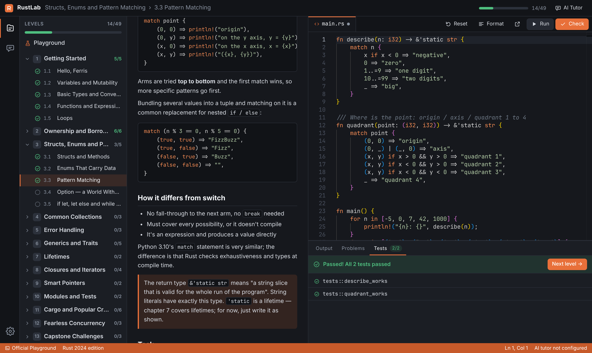

# RustLab

English · [简体中文](README.md)

A hands-on Rust course for people who **already know C++ or Python**: read a short lesson, edit code in the browser, run it, and get it checked automatically — level by level, like LabEx.



- **13 chapters, 49 levels**: from variables through ownership, traits, lifetimes, iterators, smart pointers, Cargo and popular crates (rand, serde, regex, thiserror / anyhow, clap, itertools) and concurrency, ending with three capstone challenges (word frequencies, a mini bank, an expression calculator)
- **Bilingual**: the interface and every level are available in English and Simplified Chinese; switch at any time (defaults to your browser language)
- Lessons focus on **where Rust differs from what you already know**, with C++ / Python comparisons throughout
- **A VS Code-like interface**: the Monaco editor (the same core as VS Code), compiler errors as squiggles, Problems / Output / Tests panels, rustfmt formatting, a side-by-side diff against the reference solution
- **A purely static site** that can be deployed for free to Cloudflare Pages or GitHub Pages — no server required
- **An optional AI tutor**: bring your own API key and it can see the current level and your code, explain errors and give hints (Claude, DeepSeek, Qwen, Zhipu, Kimi, OpenRouter, Gemini, a local Ollama, or any OpenAI-compatible endpoint with a custom Base URL)
- **Also works locally / in containers**: export the same levels as a cargo project and solve them in a real VS Code with rust-analyzer, checked on every save (like rustlings)

The chapter layout is inspired by [rustlings](https://github.com/rust-lang/rustlings), [The Rust Programming Language](https://doc.rust-lang.org/book/) and [course.rs](https://course.rs/); all content is original.

## Where does the code run?

The site itself is static. Compiling and running happens in one of three places (Settings → Runner); grading works the same everywhere:

| Runner | Description | Cost |
| --- | --- | --- |
| **Official Playground** (default) | The browser calls [play.rust-lang.org](https://play.rust-lang.org) directly; it allows cross-origin requests | free, zero setup |
| **Via this site** | On Cloudflare Pages, a Pages Function relays to the official Playground — for networks where it is slow or blocked | Cloudflare free tier (100k requests/day) |
| **Custom runner** | `rustc` on your own machine, in Docker or in Codespaces, see below | free |

Third-party crates work with all three: the official Playground preinstalls the few hundred most-downloaded crates, and the custom runner preinstalls the crates used in chapter 11 — rand, serde, serde_json, regex, anyhow, thiserror, itertools, clap and chrono — at the same versions as the Playground (listed in `runner/crates.mjs`).

> The official Playground is a community service; please use it fairly. For a busy classroom or workshop, have learners start the runner locally.

## Quick start (development)

Requires Node.js ≥ 22.18.

```bash
npm install
npm run dev          # http://localhost:5173, code runs on the official Playground
```

With Rust installed locally ([rustup.rs](https://rustup.rs)) you can work fully offline:

```bash
npm run dev:local    # also starts the local runner; code is compiled with your rustc
```

## Deploying to Cloudflare Pages (recommended, free)

1. Push the repository to GitHub
2. Cloudflare dashboard → Workers & Pages → Create → Pages → Connect to Git, and pick the repository
3. Build settings: framework preset **None**, build command `npm run build`, output directory `dist`, environment variable `NODE_VERSION=22`
4. Save and deploy. The `functions/` directory automatically becomes Pages Functions serving `/api/rust/*` (Playground relay) and `/api/llm/*` (AI proxy)

Or deploy from the command line:

```bash
npm run build
npx wrangler pages deploy
```

The AI proxy (`/api/llm/<host>/<path>`) forwards to any public host name — including your own OpenAI-compatible gateway — but only for model API paths (`…/chat/completions`, `…/messages`, `…/models`). It refuses IP addresses, localhost and internal host names, and only serves pages on the same site. For a strict allowlist, set `LLM_PROXY_HOSTS` (comma-separated host names) in the Pages project's environment variables.

### Other free options

- **GitHub Pages**: Settings → Pages → Source: GitHub Actions; `.github/workflows/pages.yml` builds and deploys automatically. There are no server functions, so "via this site" and the AI proxy aren't available; everything else is the same
- **Netlify / Vercel**: deploy as a regular Vite static site (also without the relays in `functions/`)
- The build uses relative paths, so `dist/` works from any static file server, in any subdirectory

## Local / container / Codespaces

### Option 1: local runner + the website

```bash
npm run runner                                  # listens on 127.0.0.1:7878 by default
# if the site is deployed on another domain, allow it explicitly:
node runner/server.mjs --allow-origin https://your-site.pages.dev
```

Then choose "Custom runner" in Settings → Runner and enter `http://127.0.0.1:7878`.
The runner has no dependencies besides Node and the Rust toolchain. It executes whatever code it receives, so by default it only listens on localhost and only accepts requests from localhost pages and origins listed with `--allow-origin`.

On start-up it pre-builds the preinstalled crates once with cargo in the background (the first time needs network access; afterwards they are cached in `~/.cache/rustlab/crates`, configurable with `RUSTLAB_CRATES_DIR`; disable with `--no-crates`). Error messages follow the website's language; console logs follow the `LANG` environment variable.

### Option 2: the runner in Docker

```bash
docker build -t rustlab-runner runner
docker run --rm -p 127.0.0.1:7878:7878 --memory 1g --cpus 2 --pids-limit 256 \
  -e ALLOW_ORIGINS=https://your-site.pages.dev rustlab-runner
```

Code is compiled and run as an unprivileged user inside the container, isolated from your system. The crates are downloaded and built while building the image, so the container needs no network access at run time.

### Option 3: GitHub Codespaces / VS Code Dev Containers

The repository includes a `.devcontainer/` configuration. On GitHub click **Code → Codespaces → Create codespace** (personal accounts get a free monthly quota), or "Reopen in Container" in a local VS Code, to get a full VS Code environment with Rust, rust-analyzer and Node:

```bash
npm run dev:local    # the website, running code with the container's rustc
```

### Option 4: solve levels in a real editor (like rustlings)

```bash
RUSTLAB_LANG=en npm run local -- export    # export to workspace/: one .rs per level, the lesson as .md next to it, plus Cargo.toml
RUSTLAB_LANG=en npm run local -- watch     # watch mode: checks on every save, then moves you to the next level
npm run local -- check 02-ownership/01-move
npm run local -- hint  02-ownership/01-move
npm run local -- list
```

`workspace/` is an ordinary cargo project (dependencies already in `Cargo.toml`), so rust-analyzer gives full completion, navigation and type hints. Grading uses exactly the same logic as the website. The language follows `RUSTLAB_LANG` (`en` / `zh`) or your `LANG`.

## AI tutor

Choose a provider, a model and your API key in Settings → AI tutor.

- "Other OpenAI-compatible API…" accepts any Base URL (for example a self-hosted one-api / new-api / LiteLLM gateway or a relay service); requests go to `Base URL + /chat/completions`, and "Fetch models" calls `/models` to list what's available
- The key is stored only in your browser's localStorage; requests go straight from your browser to the provider
- Some providers don't allow browser requests; tick "Use this site as a proxy" (requires Cloudflare Pages) and requests pass through this site's Pages Function, which neither logs nor stores anything
- Free options: Zhipu GLM's free models, SiliconFlow's free open models, OpenRouter models ending in `:free`, Gemini's free tier, or a fully offline local [Ollama](https://ollama.com) (start it with `OLLAMA_ORIGINS=* ollama serve` so web pages may call it)
- The tutor is prompted to explain errors and give direction first, and not to paste a full solution unless you explicitly ask for one

## Writing levels

A level is a Markdown file `content/<chapter>/<nn-name>.md`; chapters are registered in `content/chapters.json`:

```markdown
---
title: Level title
forbid: .clone() | unsafe     # optional: code the checker rejects (comments excluded; keywords match whole words)
min_tests: 3                  # optional: the learner must write at least N passing tests
crates: rand, serde           # optional: crates used by the level (display only)
---
Lesson text (Markdown)…

:::hint
A hint; there can be several, unlocked one at a time
:::

:::exercise
The starting code the learner sees
:::

:::tests
Tests appended to the learner's code when checking (graded by tests)
:::

:::expect
Expected standard output (graded by output when there are no tests)
:::

:::solution
Reference solution
:::
```

A level with neither `tests` nor `expect` only has to compile and exit successfully. If a level asks learners to write their own tests, put the hidden checker tests in a module named `rustlab_checks`; they don't count towards `min_tests`.

### Translations

Chinese is the source language. A translation lives next to the original with a language suffix, e.g. `01-hello.en.md`; chapter titles are translated in the `i18n` field of each entry in `chapters.json`. A translation must have a `title`, the lesson and the same number of hints as the original; `exercise` / `tests` / `expect` / `solution` override the original when present and fall back to it otherwise (translate them too whenever the code contains Chinese comments or output). Interface strings live in `src/i18n/zh.ts` and `en.ts`; the English dictionary's type is derived from the Chinese one, so a missing key is a compile error.

After editing, run the verifier. It checks that every level — and every translation that changes code — passes with its reference solution and fails with its starting code, and lists missing translations:

```bash
npm run verify                    # local rustc, all levels in parallel
npm run verify -- --only 05-err   # only some levels
npm run verify -- --playground    # verify against the official Playground
```

## Project layout

```text
content/            levels (Markdown, plus .en.md translations)
src/
  lib/parser.ts     level file parser and translation merging
  lib/check.ts      grading logic (shared by the website, the local CLI and the verifier)
  lib/runners.ts    runners: official Playground / via this site / custom runner
  lib/llm.ts        AI tutor: Anthropic SDK and OpenAI-compatible APIs
  i18n/             interface strings (zh / en)
  components/       UI (React + Monaco)
functions/api/      Cloudflare Pages Functions: Playground relay, AI proxy
shared/             the AI proxy implementation (shared by the Pages Function and the dev server)
runner/             local / container runner (dependency-free Node service, Playground-compatible API, preinstalled crates)
scripts/            verifier, local CLI, dev:local launcher
.devcontainer/      Codespaces / Dev Containers configuration
```

## Upgrading Monaco

To keep the bundle small, `src/lib/monaco-contribs.ts` imports only the editor features RustLab needs. After upgrading `monaco-editor`, regenerate it from the import list in the new version's `esm/vs/editor/editor.main.js`.

## License

MIT
