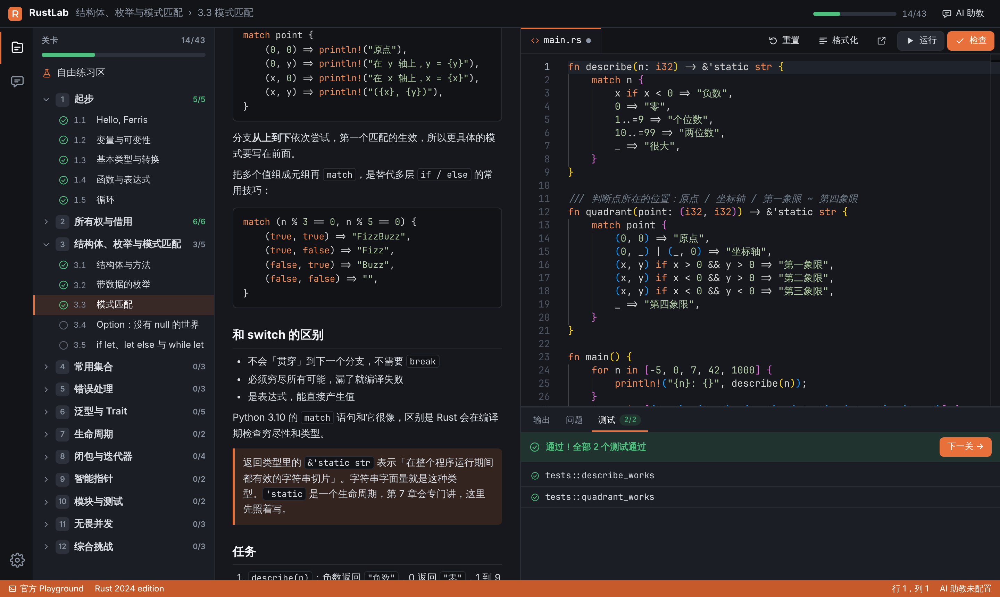

# RustLab · Rust 闯关实验室

面向**已经会 C++ 或 Python** 的人的 Rust 入门教程：边读边写，浏览器里编辑、运行、自动判题，像 LabEx 一样一关一关往下走。



- **12 章 43 关**，从变量一路到所有权、trait、生命周期、迭代器、智能指针、并发，最后是三个综合挑战（词频统计、迷你银行、表达式计算器）
- 讲解只讲 **「Rust 和你熟悉的语言哪里不一样」**，处处拿 C++ / Python 做对比
- **类 VS Code 的界面**：Monaco 编辑器（VS Code 同款内核）、编译错误直接画波浪线、问题 / 输出 / 测试面板、rustfmt 格式化、参考答案 diff 对比
- **纯静态网站**，可以免费部署到 Cloudflare Pages / GitHub Pages，不需要任何服务器
- **可选的 AI 助教**：填自己的 API Key，它能看到当前关卡和你的代码，帮你解释报错、给思路（支持 Claude、DeepSeek、通义千问、智谱、Kimi、OpenRouter、Gemini、本地 Ollama 等）
- **也能在本地 / 容器里做**：同一套关卡可以导出成 cargo 项目，在真正的 VS Code + rust-analyzer 里做，保存即判题（类似 rustlings）

关卡的章节编排参考了 [rustlings](https://github.com/rust-lang/rustlings)、[The Rust Programming Language](https://doc.rust-lang.org/book/) 和 [Rust 语言圣经](https://course.rs/)，内容为原创。

## 代码在哪里运行？

网页本身是纯静态的，代码的编译运行有三种选择（在「设置 → 运行环境」里切换，判题逻辑完全一样）：

| 方式 | 说明 | 费用 |
| --- | --- | --- |
| **官方 Playground**（默认） | 浏览器直接请求 [play.rust-lang.org](https://play.rust-lang.org)，它允许跨域访问 | 免费，零配置 |
| **经本站转发** | 部署在 Cloudflare Pages 时，由 Pages Function 转发到官方 Playground，适合官方地址访问不畅的网络 | Cloudflare 免费额度（每天 10 万次请求） |
| **自定义运行器** | 用你自己机器 / Docker / Codespaces 里的 `rustc`，见下文 | 免费 |

> 官方 Playground 是 Rust 社区提供的公益服务，请合理使用。人多的课堂或培训，建议让学员在本机启动运行器。

## 快速开始（本地开发）

需要 Node.js ≥ 22.18。

```bash
npm install
npm run dev          # http://localhost:5173 ，代码交给官方 Playground 运行
```

如果本机装了 Rust（[rustup.rs](https://rustup.rs)），也可以完全离线：

```bash
npm run dev:local    # 同时启动本机运行器，代码用本机 rustc 编译运行
```

## 部署到 Cloudflare Pages（推荐，免费）

1. 把仓库推到 GitHub
2. Cloudflare 控制台 → Workers & Pages → 创建 → Pages → 连接到 Git，选中这个仓库
3. 构建设置：框架预设选 **None**，构建命令 `npm run build`，输出目录 `dist`，环境变量 `NODE_VERSION=22`
4. 保存并部署。`functions/` 目录会自动成为 Pages Functions，提供 `/api/rust/*`（Playground 转发）和 `/api/llm/*`（AI 代理）

也可以用命令行部署：

```bash
npm run build
npx wrangler pages deploy
```

AI 代理默认只转发到常见模型服务商的域名。要增加其它服务商，在 Pages 项目的环境变量里设置 `LLM_PROXY_HOSTS`（逗号分隔的完整列表）。

### 其它免费方案

- **GitHub Pages**：仓库 Settings → Pages → Source 选 GitHub Actions，`.github/workflows/pages.yml` 会自动构建部署。没有服务端函数，所以「经本站转发」和 AI 代理不可用，其余一样
- **Netlify / Vercel**：当作普通 Vite 静态站点部署即可（同样不含 `functions/` 里的转发）
- 构建产物使用相对路径，`dist/` 放到任何静态文件服务器的任意子目录下都能用

## 本地 / 容器 / Codespaces

### 方式一：本机运行器 + 网页

```bash
npm run runner                                  # 默认监听 127.0.0.1:7878
# 如果网页部署在别的域名上，需要明确允许它：
node runner/server.mjs --allow-origin https://你的站点.pages.dev
```

然后在网页的「设置 → 运行环境」里选「自定义运行器」，地址填 `http://127.0.0.1:7878`。
运行器零依赖，只用 Node 和本机的 `rustc` / `rustfmt`。它会执行收到的任意代码，所以默认只监听本机，并且只接受 localhost 和 `--allow-origin` 列出的页面发来的请求。

### 方式二：Docker 容器里的运行器

```bash
docker build -t rustlab-runner runner
docker run --rm -p 127.0.0.1:7878:7878 --memory 1g --cpus 2 --pids-limit 256 \
  -e ALLOW_ORIGINS=https://你的站点.pages.dev rustlab-runner
```

代码在容器里以普通用户身份编译运行，和你的系统隔离。

### 方式三：GitHub Codespaces / VS Code Dev Containers

仓库带有 `.devcontainer/` 配置。在 GitHub 上点 **Code → Codespaces → Create codespace**（个人账号每月有免费额度），或在本地 VS Code 里「Reopen in Container」，就能得到一个装好 Rust、rust-analyzer 和 Node 的完整 VS Code 环境：

```bash
npm run dev:local    # 网页版，代码用容器里的 rustc 运行
```

### 方式四：在真正的编辑器里做题（类似 rustlings）

```bash
npm run local -- export    # 导出到 workspace/：每关一个 .rs，旁边是讲解 .md，外加 Cargo.toml
npm run local -- watch     # 监视模式：保存文件就自动判题，通过后提示下一关
npm run local -- check 02-ownership/01-move
npm run local -- hint  02-ownership/01-move
npm run local -- list
```

`workspace/` 是一个普通的 cargo 项目，rust-analyzer 能完整地提供补全、跳转和类型提示。判题用的是和网页完全相同的逻辑。

## AI 助教

在「设置 → AI 助教」里选择服务商、填写模型名和 API Key。

- Key 只保存在浏览器的 localStorage 里，请求从浏览器直接发给服务商
- 有的服务商不允许浏览器跨域访问，这时勾选「通过本站代理」（需要部署在 Cloudflare Pages 上），请求会经过本站的 Pages Function 转发，函数不记录、不保存任何内容
- 免费的选择：智谱 GLM 的免费模型、硅基流动的免费开源模型、OpenRouter 上以 `:free` 结尾的模型、Gemini 的免费额度，或者完全离线的本地 [Ollama](https://ollama.com)（用 `OLLAMA_ORIGINS=* ollama serve` 启动以允许网页访问）
- 助教的提示词要求它先引导思路、解释报错，除非你明确要求，否则不直接贴出整关答案

## 编写关卡

关卡是 `content/<章节>/<序号-名字>.md` 里的 Markdown 文件，章节在 `content/chapters.json` 里登记：

```markdown
---
title: 关卡标题
forbid: .clone() | unsafe     # 可选：判题时禁止出现的写法（注释除外）
min_tests: 3                  # 可选：要求学习者自己写至少 N 个通过的测试
---
讲解正文（Markdown）……

:::hint
提示，可以有多条，逐条解锁
:::

:::exercise
学习者看到的初始代码
:::

:::tests
判题时追加在学习者代码后面的测试（用测试判题）
:::

:::expect
期望的标准输出（没有 tests 时，用比对输出判题）
:::

:::solution
参考答案
:::
```

既没有 `tests` 也没有 `expect` 的关卡，只要求能编译并正常退出。如果关卡要求学习者自己写测试，隐藏的判题测试请放在名为 `rustlab_checks` 的模块里，它们不计入 `min_tests`。

改完之后运行校验，它会确认每一关的参考答案能通过、初始代码不能直接通过：

```bash
npm run verify                    # 用本机 rustc，并行校验全部关卡
npm run verify -- --only 05-err   # 只校验部分关卡
npm run verify -- --playground    # 用官方 Playground 校验
```

## 项目结构

```text
content/            关卡内容（Markdown）
src/
  lib/parser.ts     关卡文件解析
  lib/check.ts      判题逻辑（网页、本地 CLI、校验脚本共用）
  lib/runners.ts    运行环境：官方 Playground / 本站转发 / 自定义运行器
  lib/llm.ts        AI 助教：Anthropic SDK 与 OpenAI 兼容接口
  components/       界面（React + Monaco）
functions/api/      Cloudflare Pages Functions：Playground 转发、AI 代理
runner/             本地 / 容器运行器（零依赖 Node 服务，兼容 Playground 接口）
scripts/            关卡校验、本地做题 CLI、dev:local 启动脚本
.devcontainer/      Codespaces / Dev Containers 配置
```

## 升级 Monaco

为了减小体积，`src/lib/monaco-contribs.ts` 只引入了需要的编辑器功能。升级 `monaco-editor` 之后，对照新版本 `esm/vs/editor/editor.main.js` 里的 import 列表重新生成这个文件即可。

## 许可

MIT
